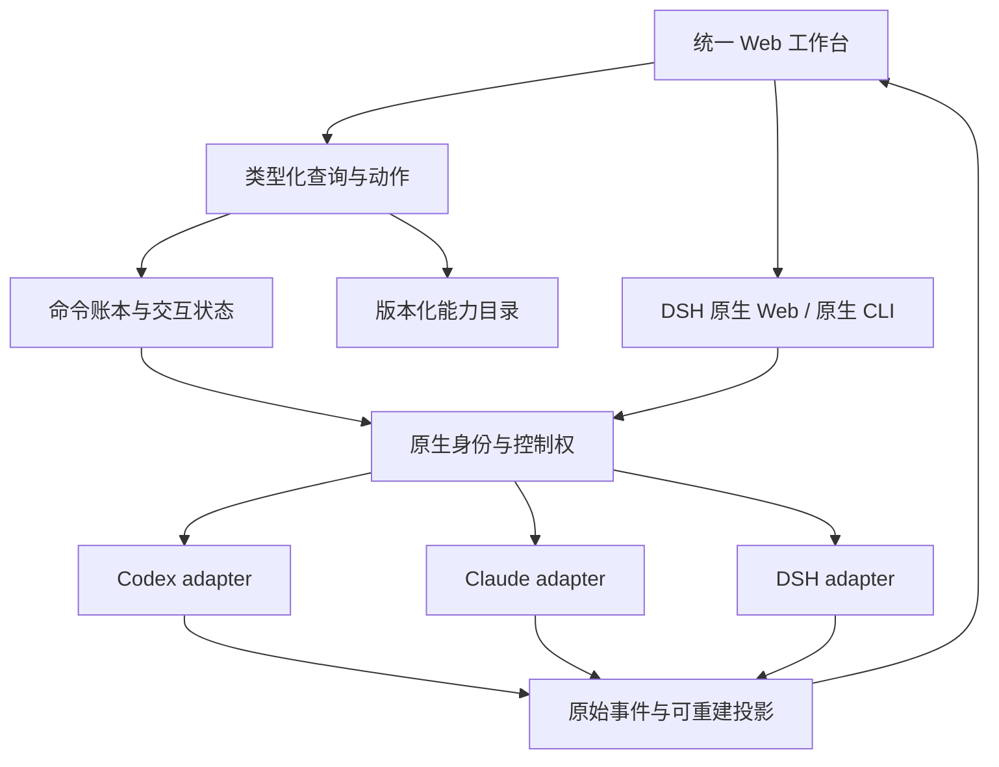

# WebDCC 原生功能对等 SPEC

> 文件：`WebDCC_NATIVE_PARITY_SPEC.md`  
> 版本：1.0 / 设计评审稿，可据此分解实现；不是已实现声明。  
> 日期：2026-11-14（Asia/Shanghai）  
> 审计基线：[`9b1ae9096c19162206361e3910b7ef2592c5f30b`](https://github.com/codezzzsleep/WebDCC/blob/9b1ae9096c19162206361e3910b7ef2592c5f30b/README.md)  
> 配套：`WebDCC_REVIEW.md`（问题与证据）、`WebDCC_IMPLEMENTATION_CONSTRAINTS.md`（硬约束与逐项预算）、`IMPLEMENTATION_MATRIX.json`（机器可读需求映射）。

## 1. 目的与产品决定

把 WebDCC 从“三个原装 Agent 的统一聊天与事件展示台”，推进为“在浏览器中可发现、操作、观察并恢复原生能力的工作台”。三个 Agent 继续拥有模型循环、工具执行、用户配置和安全判断。WebDCC 负责控制入口、身份映射、事件保真、持久化和用户体验。

本 SPEC 采用的设计假设是：用户要求通过浏览器获得原生功能，不强制所有功能都由一套自绘 React 控件重写。因此推荐“高频能力结构化 UI + DSH 原生 Web surface + Codex/Claude 原生 CLI surface”。该选择是本次设计建议，不能表述为用户已确认的偏好。原生入口必须真正远程可达、可操作且可验证；一个指向服务器 loopback 的链接、一个空终端或只能打开首页的 iframe 都不算完成。

若要求每个功能都使用统一自绘 UI，则 NP-39/40/41 中的原生入口交付不能算该项的结构化完成，须启动第 13 节的扩展路线。两种目标分别记录覆盖，不混成一个百分比。

### 1.1 新文档与旧文档的优先级

实施本次需求时，采用“当前用户需求 → 本 SPEC 与配套约束 → 已验证的锁定原生协议 → 旧 SPEC 仍不冲突的部分”。`docs/protocol-notes.md` 是历史证据，不能永久覆盖更新后的真实类型与运行时握手。冲突必须记录为 ADR/迁移决定，不能让旧的禁止条款阻止本次已请求的目标，也不能据此擅自扩大到自动多 Agent 编排。

本 SPEC 明确替代旧 [`SPEC.md` 非目标](https://github.com/codezzzsleep/WebDCC/blob/9b1ae9096c19162206361e3910b7ef2592c5f30b/SPEC.md#L85-L112)中不导入外部历史、不提供 PTY、不提供 DSH 原生 UI 的产品范围限制。保留以下原则：不悄悄改变提示词，不自动给模型附加平台工具/skills/hooks，不伪造原生输出，不自动跨 Agent 交接，按原生权限进行审批。

“不修改用户配置”细化为：没有用户明确操作不得改；用户在 Web 中主动管理其原生设置、MCP、skills 或插件时，必须明确目标、作用域、差异和持久性，优先调用原生配置接口。平台观察器、Watchdog 等扩展不冒充原装行为，默认关闭并标明来源。点击原生 fork/compact/goal 等结构化动作是用户操作；它不应被实现为偷偷发一段自然语言提示。

## 2. 原生对等的边界与完成定义

### 2.1 冻结基线

初始以仓库声明的 Codex CLI 0.167.0、Claude Code 2.1.322 / Agent SDK 0.3.322、DSH 0.2.2-rc.1 为协议基线。部署 OS 为 Linux、使用者为单一服务器主人。运行时必须验证实际版本；这些常量不是本次已运行三家原生进程的证明。更新到新版本属于显式升级任务，不承诺自动追随“未来所有版本”。来源见 [deploy](https://github.com/codezzzsleep/WebDCC/blob/9b1ae9096c19162206361e3910b7ef2592c5f30b/docs/deploy.md)、[Codex schema](https://github.com/codezzzsleep/WebDCC/blob/9b1ae9096c19162206361e3910b7ef2592c5f30b/packages/adapters/codex/src/schema/ClientRequest.ts)、[DSH catalog](https://github.com/codezzzsleep/WebDCC/blob/9b1ae9096c19162206361e3910b7ef2592c5f30b/fixtures/dsh/host-api-catalog.json)。

能力库存同时覆盖：会话/历史/分叉与回退；输入/图片/文件/引用；模型/推理/服务档位；权限/审批/问答/elicitation；计划/目标/任务/子Agent；命令/后台进程/终端；MCP/skills/hooks/plugins/apps；账号/认证/额度；配置/项目/工作树/Review；原生资源/动态UI；DSH日程/Forge/分享/语音等实际可用扩展。

API方法数量仅用于检查库存完整性。传输握手、telemetry、内部辅助等不要求独立按钮；同样，多个方法可能组成一个用户功能。没有公共API但原生CLI能执行的用户功能仍属于目标分母，不能因实现困难删除。

### 2.2 每项能力的五段闭环

1. **可发现**：用户知道功能存在、作用对象和前置条件。
2. **可操作**：浏览器中能执行原生动作，含合法参数、取消、拒绝和失败路径。
3. **可观察**：原生进度、输出、权限与副作用如实呈现，主/子会话归属正确。
4. **可恢复**：刷新、网络中断、服务重启、原生连接变化后状态能对账；不能保证恢复时明确 uncertain。
5. **可验证**：同配置的原生对照、真实触发证据和Web操作结果绑定同一版本/提交。

“原生工具被加载”“工具调用能显示JSON”“回放帧不变量通过”分别是有用证据，均不足以单独证明完整对等。

### 2.3 诚实的能力状态

每项必须使用独立状态轴：`nativeAvailability = available / environment-blocked / not-applicable / unknown` 表示目标部署原生是否拥有能力；`apiExposure = public / experimental / unsupported-in-api / unverified` 表示本客户端API能否直接控制。再分别记录结构化实现/验证和原生后备验证状态。CLI有但API没有的能力仍是native available，仍在N中。`implemented` 与 `verified` 不得合并；没有验证的后备入口不能算通过。unknown/unverified必须继续调查或列为阻断，不能用来缩小分母后宣称全功能。

对部署基线中实际可用的用户功能集合 N：

- 可操作覆盖率 = 在结构化 UI 或已验证原生入口完成五段闭环的能力数 / |N|。
- 结构化覆盖率 = 只在统一结构化 UI 完成闭环的能力数 / |N|。
- 库存分类覆盖率必须为100%；发布“全原生功能”要求可操作覆盖率100%，且没有未分类/未测试但被标pass的项目。

如果某个目标能力因账号、设备、平台或API限制无法实现，必须列出缺口和解除条件；不能将它改成不需要后仍宣称无条件全功能。Windows专属沙箱、原生桌面独有硬件并不会因提供Linux浏览器入口而出现。

## 3. 用户旅程

| 旅程 | 成功条件 | 相关需求 |
|---|---|---|
| 开箱连接三家原生运行时 | 正确检测版本、登录、配置来源和可用模型；不改用户默认设置 | NP-01/07/16/28/46 |
| 在浏览器完成复杂工具任务 | 能看原生进度、处理审批/多题/secret/MCP表单、查看真实文件结果 | NP-05/06/08/09/11/17/25/29 |
| 运行中调整任务 | 区分新轮、队列、steer、任务停止；掉线和重启不丢已接收输入 | NP-03/04/19/24/32/33 |
| 从原生CLI/DSH已存在会话继续 | 发现、预览、关联同nativeId；回到原版时状态不分叉 | NP-10/20/21/44 |
| 原生fork/revert/rewind/compact | 语义与覆盖范围明确，实际调用原生功能，失败有终态 | NP-22/31/35 |
| 管理原生能力与设置 | 查看并显式修改自己的MCP/skills/hooks/plugins/preset，不暗中注入 | NP-12/25/26/27/37 |
| 使用暂未结构化的长尾功能 | 可在远程浏览器打开真实native surface，目标身份和权限正确 | NP-34/36/39/40/41/42/43/44 |
| 换设备/服务升级后继续 | URL有效、恢复有证据、迁移不丢事件与附件、性能有边界 | NP-05/45/46/47/48 |

## 4. 目标架构



保留 monorepo、TypeScript、React/Vite、Fastify、SQLite 和每Agent adapter；不引入微服务、消息中间件或替换数据库作为本次前提。共享层负责身份、持久化、同步、交互框架与公共展示。原生专属行为保留在各Agent能力域，不为了统一而压缩为最小公分母。

逐步从现有adapter提取模块，同时保持旧facade可用；先有对照测试再转移调用。生产和回放共用reducer与相同状态转移。原生surface保留原生交互和重试语义；Web不能解析终端键入后擅自“幂等重放”用户命令。

## 5. 关键数据合同

下面是必须满足的逻辑模型，字段可因实际数据库迁移做等价调整；已知native payload必须用对应版本的类型，不能把以下 `unknown` 当成任意RPC通行证。

```ts
type NativeAddress =
  | { kind: 'session'; sessionId: string }
  | { kind: 'subagent'; parentSessionId: string; childSessionId: string;
      mode: 'one-shot' | 'continuable' | 'unknown' };
type NativeSessionRef = {
  agent: 'codex' | 'claude-code' | 'dsh';
  hostId: string;
  nativeSessionId: string;
  nativeVersion: string;
  profile?: string;
  address?: NativeAddress; // DSH子会话必须保留父身份与mode，不能仅凭childId执行
};
type ModelRef = { agent: NativeSessionRef['agent']; providerId: string; modelId: string };
type CommandState = 'received' | 'queued' | 'dispatching' | 'native-accepted'
  | 'completed' | 'failed' | 'cancelled' | 'uncertain';
type CommandRecord = {
  commandId: string; payloadHash: string; sessionRef: NativeSessionRef;
  capabilityId: string; capabilityRevision: string; payload: unknown;
  state: CommandState; nativeRequestId?: string | number; nativeTurnId?: string;
  generation: number; createdAt: string; result?: unknown; error?: unknown;
};
type NativeEnvelope = {
  sessionRef: NativeSessionRef; generation: number; receivedAt: string;
  nativeEventKey?: string; nativeSeq?: number; actorId?: string;
  nativeTurnId?: string; nativeItemId?: string; nativeRequestId?: string | number;
  methodOrType: string; schemaHash: string; payload: unknown;
};
type InteractionState = 'pending' | 'sending' | 'resolved' | 'failed' | 'expired' | 'cancelled' | 'uncertain';
// InteractionRequest必须为原生命令审批/文件审批/权限审批/问答/MCP表单/MCP URL/dialog等联合。
// 每个分支分别携带该native版本定义的request/response类型和validation schema。
```

### 5.1 必须分开的身份与状态

- Web session ID / native session ID / native actor ID / native turn ID / UI turn ID。
- 本地事件 `seq` / native event identity或seq / 原生连接generation。
- 用户请求的模型与权限 / 原生确认的实际模型与权限。
- 已知服务端末尾 / 已成功缓存的连续事件区间 / 历史中尚未拉取的gap。
- 命令已持久接收 / native已接收 / 原生副作用完成 / 网络失败但结果不确定。
- WebDCC自有会话组织与原生metadata；平台自动恢复与原生自主continuation。

### 5.2 存储与迁移

新增或等价扩展 `native_sessions`、`command_journal`、`input_queue`、`native_event_envelopes`、`interactions`、`capability_snapshots`、`native_owners`。唯一约束包括 `(host, agent, nativeSessionId)`、`commandId` 与其payloadHash、原生事件source identity。队列ordinal与状态更新在事务内完成。

旧events保持只增不改；重建UI投影采用projectionVersion。对旧raw缺失的数据保留“历史证据不完整”而不是补造原生消息。命令已提交原生后崩溃时，优先查询native状态；无法证明则停在uncertain，显示待核对，不能为了自动化体验强行重放。从M0第一次数据库变更开始就必须带迁移与回滚保护；M3的NP-47负责完整备份恢复演练，不是推迟基础迁移。

## 6. HTTP/WebSocket合同与能力执行

以下是建议接口，既有路径可复用，但语义必须满足：

| 接口 | 语义 |
|---|---|
| GET `/api/capabilities?agent=&workspaceId=` | 返回runtime版本、能力、配置来源、revision、缺失原因与surface入口 |
| POST `/api/commands` | 接收已登记的typed capability action，先持久化后ACK；payload冲突409 |
| GET `/api/commands/:commandId` | 返回完整状态、原生身份、error及是否允许重试 |
| GET `/api/native-sessions` | 有界分页发现原生历史，包含Host/Agent与读取范围 |
| POST `/api/native-sessions/attach` | 用户选择后建立关联/接管计划，不默认抢占owner |
| GET `/api/sessions/:id/interactions` | 权威未决与已解决交互投影，可按requestId重建 |
| POST `/api/interactions/:id/responses` | schema验证、request revision与generation匹配，通过同一命令账本处理 |
| GET `/api/sessions/:id/events` | 持久seq分页；原始信封与投影可分别读取；返回覆盖区间 |
| WS `/api/ws` | feed、受限live window、snapshot、delta、command状态、backpressure与恢复水位 |
| `/native/dsh/...` 或隔离origin | 已登记Host的受认证原生surface，非任意URL代理 |
| WS `/api/native-terminal/:id` | 已授权owner的PTY duplex；不将终端输入混入普通聊天outbox |

浏览器不能提交任意`method`字符串让服务端透传。`capabilityId`必须在注册表中绑定typed handler、native方法、权限、参数schema和结果schema。原生surface代理本身按固定目标/限定路由/认证边界工作，不是绕过注册表的任意网络代理。

## 7. 详细功能需求

所有 NP 编号都是交付单元，不是一个PR。每项的代码/测试/文件估算见配套约束中的同名编号。文件路径为当前触点或明确标注的新模块，不要求机械照搬目录名称。编号顺序不是执行顺序：例如原生surface NP-42/43应先于依赖它的长尾功能实施。

## M0：正确性、协议与可重复验证

### NP-01 · 冻结原生基线与能力清单

**当前差距：** 版本常量、静态菜单、已导出的协议和实际运行环境没有形成同一份可验证能力清单。

**必须行为：** 新增 CapabilityRegistry，按 agent、binary/SDK版本、OS、profile、Host身份、账号状态、Provider、插件集合记录能力。每项分别记录 nativeAvailability、apiExposure、structuredImplemented、structuredVerified、fallbackVerified、reason 与证据，不用一个 supported 布尔值替代。启动、配置变更和连接代际变化均刷新。 unknown/unverified是显式待验证状态，不能用来缩小全功能分母；发布前逐项消除或列为阻断。

**原生映射与边界：** 以本仓 Codex 0.167.0 ClientRequest/ServerRequest/ServerNotification，Claude SDK 0.3.322公开类型，DSH 0.2.2-rc.1的193端点目录为初始库存；实际握手结果可使能力降级。

**验收：**

1. 每个原生方法和每个用户功能都映射到 capabilityId、内部辅助或明确排除理由，未分类数量为0。
2. UI与服务端使用同一snapshot revision；模型/插件变化后旧revision动作得到409及刷新指引。
3. 缺登录、缺插件、实验功能未协商、版本不兼容均可观察，不被标为平台已实现。

**实施触点：** protocol/src/capabilities.ts（新）；server capability-registry（新）；adapters/* capability providers（新）；web capability hooks（新）。

**依赖：** 无。**交付方式：** 结构化。**估算：** 实现 220–400 行，测试 180–320 行，触及 6–10 个文件；置信度中高。

### NP-02 · 类型化原生协议与分域适配器

**当前差距：** 导出的schema存在，但大量Record<string, unknown>和强制转换仍让错误wire参数通过类型检查；adapter把传输、生命周期、交互、映射混在一起。

**必须行为：** 保持AgentAdapter外观兼容，逐步提取Transport、NativeSessionBridge、InteractionCoordinator、纯EventReducer和NativeControls。已知request/result必须使用锁定类型并在边界校验。未知方法明确unsupported，不能当通用批准。

**原生映射与边界：** Codex保留string或number JSON-RPC ID；Claude使用公开SDK类型；DSH校验payload.args和每端点参数描述符。schema只通过原生导出更新。

**验收：**

1. 所有已用native方法的请求与响应通过合同测试，错误字段和错误枚举必失败。
2. 生产与回放调用同一reducer，不允许回放独有的语义补帧。
3. 清理监听器、进程、流和诊断缓冲；失败启动后资源计数回到基线。

**实施触点：** adapters/codex/src/{rpc,adapter}.ts；adapters/claude/src/adapter.ts；adapters/dsh/src/{host,adapter}.ts；各域新模块。

**依赖：** NP-01。**交付方式：** 结构化。**估算：** 实现 750–1,300 行，测试 450–800 行，触及 14–24 个文件；置信度中。

### NP-03 · 持久命令账本、幂等与持久队列

**当前差距：** 去重在execute之后写入，且排队正文仅在runtime.queued；成功ACK后浏览器删除outbox，崩溃可重复执行或丢输入。

**必须行为：** 在SQLite事务中先占有commandId并写payload hash、session、动作和状态，成功持久接收后才能ACK。队列正文/附件/顺序持久化；同ID同payload复用结果，同ID异payload返回409。原生提交的未知结果进入uncertain并对账，不能盲目重发。

**原生映射与边界：** 利用原生requestId/turnId可查证部分实现去重；没有原生幂等能力时明确不保证外部副作用exactly-once。

**验收：**

1. 同一命令100个并发HTTP/WS请求只进入一次执行；同ID异内容被拒。
2. 在received/queued/dispatching/native-accepted各边界kill进程后恢复，消息仍可见，原生已执行的不会自动重复。
3. accepted队列可查看、取消、按版本调整；失败与uncertain都有可操作恢复路径。

**实施触点：** server/src/{db,store,dispatcher,manager}.ts；protocol/src/sync.ts；web/src/lib/{store,db}.ts；新command-journal/queue。

**依赖：** NP-02。**交付方式：** 结构化。**估算：** 实现 700–1,200 行，测试 550–950 行，触及 8–13 个文件；置信度中高。

### NP-04 · 会话所有权、运行代际与故障恢复

**当前差距：** runtime只靠sessionId；resume/换模型/旧进程迟到消息可能串入，新旧native turn与本地turn边界不一致。

**必须行为：** 每个native会话有owner、generation、activeNativeTurn、lastObservedSeq和single-flight activation。任何异步回调携带generation；旧代际仅可作为诊断记录。区分Web服务重启、原生进程重启和浏览器重连，先读取权威状态再派生idle/running。

**原生映射与边界：** 原生自主continuation必须更新active turn；attach外部Host不能因为Web重启就伪造其已中断。

**验收：**

1. 并发resume只创建一个owner，旧query晚到不能污染新会话。
2. 活动native turn的interrupt总指向当前ID，取消完成由native结果确认。
3. 服务端重启时区分原生仍运行/已退出/未知，不把所有情况都标用户打断。

**实施触点：** server/src/manager.ts；server native-runtime（新）；protocol runtime types（新）；三个adapter lifecycle。

**依赖：** NP-02、NP-03。**交付方式：** 结构化。**估算：** 实现 450–800 行，测试 350–650 行，触及 7–11 个文件；置信度中。

### NP-05 · 无损原生事件、同步水位与可重建投影

**当前差距：** 部分事件被丢弃，raw与UI投影未彻底分离；首屏历史失败仍推进cursor；snapshot合并残留热条目。

**必须行为：** 原生信封先持久化再投影，保存source identity、generation和schema版本。分开记录serverLastSeq与客户端已覆盖区间；只有成功落缓存的连续段才推进水位。带版本snapshot替换对应热状态。raw及未知事件在独立检查器可读，不能仅保存不可访问JSON。

**原生映射与边界：** 保留native session/actor/turn/item/request IDs；内部帧可不进聊天，但必须有忽略理由或诊断去向。敏感凭据例外按NP-14最小化留存。

**验收：**

1. 历史API首次失败后下一次能补齐缺口，afterSeq不越过未接收区间。
2. 同native事件重放10次只有一个语义投影，空snapshot清除旧hot。
3. 任意seq，包括turnId=null、unknown、内部帧，都能定位查看；live与replay结果一致。

**实施触点：** server/src/{store,hub,manager,turn-tracker}.ts；protocol/src/{events,turn}.ts；web/src/lib/{store,db}.ts；EventInspector（新）。

**依赖：** NP-02、NP-04。**交付方式：** 结构化。**估算：** 实现 650–1,100 行，测试 450–800 行，触及 9–15 个文件；置信度中。

### NP-06 · 审批、提问和Elicitation完整状态机

**当前差距：** 简单optionId和selected/custom不足以承载secret、多题、权限增量、MCP表单；UI提前宣称成功，刷新有重复pending卡。

**必须行为：** 使用discriminated union保存request类型、schema、options、scope、deadline、native身份、request group和revision；pending→sending→resolved/failed/expired/cancelled/uncertain。一个request只生成一张权威投影，负ACK保留错误并允许合法重试。多题按原生group原子回复。 native可能已接收但响应丢失时，interaction与command共同进入uncertain；对账前不解除重试限制。

**原生映射与边界：** Codex command/file/permissions/userInput/MCP各自响应；Claude canUseTool、onElicitation、公开dialog callbacks；DSH waterfall/callId/durable approval关联。

**验收：**

1. 自由文本、单选、多选、多题、secret、URL/form elicitation逐项以UI payload到native response断言。
2. 三种结局允许/拒绝/取消都验证；两个浏览器同时回应只有一次native决定。
3. refresh/掉线/原版UI完成后旧按钮不可再次提交；acceptForSession显示真实授权范围。

**实施触点：** protocol interactions（新）；server interaction store/coordinator（新）；adapters/* handlers；web Approval/Question/Dialog组件。

**依赖：** NP-03、NP-05。**交付方式：** 结构化。**估算：** 实现 850–1,450 行，测试 700–1,150 行，触及 11–18 个文件；置信度中。

### NP-07 · 原生权限默认值与实际生效状态

**当前差距：** 未选择模式仍被第一项覆盖；Codex下一轮字段错误；Claude换模型可能恢复旧权限；UI把请求值当生效值。

**必须行为：** 新增inherit模式，缺省不传覆盖。requested与effective分开；目录保留allowed、reason、来源及作用域。降权若需等待下一轮，应明确pending，不能即刻显示已生效；任何升级权限必须是用户明确动作。

**原生映射与边界：** Codex thread/start的sandbox与turn/start的sandboxPolicy分别类型化；Claude setPermissionMode后更新持久launch state；DSH使用permission catalog/原生命令及原生状态。

**验收：**

1. 用户配置为非默认模式时，无选择新建会话保持该配置。
2. workspace-write→read-only在下一native执行前可证实生效；失败不显示成功。
3. 换模型、resume、服务重启后权限一致；不可应用的profile和managed限制不可选。

**实施触点：** server/src/manager.ts；三adapter access methods；protocol permission types（新）；web Composer/SessionHeader。

**依赖：** NP-01、NP-02、NP-06。**交付方式：** 结构化。**估算：** 实现 350–650 行，测试 350–600 行，触及 6–10 个文件；置信度高。

### NP-08 · Codex事件和反向请求正确性修复

**当前差距：** reasoning.summary按错误形状读取、plan.text被当items；未知反向请求当exec_command审批；自主turn启动未更新interrupt目标。

**必须行为：** 按锁定ThreadItem/ServerRequest做穷举映射；string ID不转Number；保持reasoning分段、plan markdown、actor和late items；未知请求返回可诊断协议错误或原生规定的拒绝，禁止猜测响应。

**原生映射与边界：** 修复本次局部复现；修复范围为现有事件与调用，不在本项塞入新的native管理功能。

**验收：**

1. summary=[a,b]与plan.text均完整显示且只出现一次。
2. MCP elicitation、permissions和auth refresh不会走command卡片；没有合法handler时无假成功。
3. 原生turn/started后不经send也能interrupt；请求ID字符串往返不变。

**实施触点：** adapters/codex/src/{adapter,rpc}.ts；新event handlers；codex handler/routing测试。

**依赖：** NP-02、NP-06。**交付方式：** 结构化。**估算：** 实现 250–480 行，测试 350–600 行，触及 5–9 个文件；置信度高。

### NP-09 · Claude块级事件与运行控制正确性修复

**当前差距：** 完成时多text block被整段重复覆盖；非init system/未知SDK消息生产路径丢弃；task与执行错误分类不准确。

**必须行为：** 按native session/message/block/parent_tool_use_id构建identity，主/子actor独立归约。保留compact/status/task/hook/未知系统消息，失败和用户中断分开。更新参数走SDK已支持控制方法，必须重启时用generation交接。

**原生映射与边界：** 适配锁定SDKMessage全联合；TaskCreate/Update以成功返回的真实ID归约，不能预猜序号。

**验收：**

1. 两个text block完成态保持各自内容，主子输出交错不串线。
2. compact/task/status生产listener与replay具有相同保留策略。
3. 权限切换后换模型保持effective权限；工具失败不产生成功任务或用户中断假象。

**实施触点：** adapters/claude/src/adapter.ts；Claude reducer/runtime/task modules（新）；对应handler tests。

**依赖：** NP-02、NP-04、NP-06。**交付方式：** 结构化。**估算：** 实现 350–650 行，测试 400–700 行，触及 6–10 个文件；置信度中高。

### NP-10 · DSH连接、重订阅与历史恢复

**当前差距：** remote.mux关闭后没有完整重连；snapshot/user.message被丢弃；attach切换未重开旧follow；路径前缀被截断。

**必须行为：** 实现HTTP deadline、WS generation/backoff、过期认证可见、subscription registry和snapshot/page补读。保留origin+basePath，正确HTTPS/WSS。断开操作同时停止订阅并持久化null。CLOSED close幂等，boot失败清理。

**原生映射与边界：** workspace/follow、session/follow开场snapshot与session/page游标；$events clientId随generation更新。外部user/message按identity去重，不再全丢。

**验收：**

1. 只切断native WS保持HTTP后恢复，旧会话继续收流并补全期间事件。
2. 原版UI发消息、WebDCC离线后回归，双方历史一致；不会重复本地预写user.message。
3. 带路径前缀链接、断开重启、Host重启、cookie过期和已关闭socket全部有终态。

**实施触点：** adapters/dsh/src/{host,adapter}.ts；server/src/dsh-connection.ts；native history bridge（新）。

**依赖：** NP-04、NP-05。**交付方式：** 结构化。**估算：** 实现 850–1,450 行，测试 650–1,100 行，触及 8–14 个文件；置信度中高。

### NP-11 · DSH交互与子Agent协议修正

**当前差距：** subagents/prompt参数未包request且缺父身份；interruptByUser不在锁定目录；审批id/outcome映射错误；回答失败前已删除pending。

**必须行为：** 修正子Agentwire及父子权限检查；保存callId、durable approval id、waterfall eventId映射；$events取消/原版解决能收敛。native ACK前不删pending；超时先对账。

**原生映射与边界：** 使用subagents/interruptByParent；continuable child显式mode，one-shot child不提供非法继续。计时问题使用userQuestions/answer/attachWait支持范围。

**验收：**

1. 所有调用通过锁定catalog参数校验，父身份不匹配返回拒绝。
2. 首次答案网络失败后可安全重试，不丢问题。
3. fixture的{id,outcome}决定生成resolved；原版UI解决或取消后Web只有一个最终状态。

**实施触点：** adapters/dsh/src/adapter.ts；DSH interaction/subagent modules（新）；server subagent routes；UI cards。

**依赖：** NP-06、NP-10。**交付方式：** 结构化。**估算：** 实现 350–650 行，测试 400–700 行，触及 6–10 个文件；置信度高。

### NP-12 · 原生配置修改的作用域与一致性

**当前差距：** DSH settings异常fallback会写WebDCC主机的home patch，可能改错远程Host，模型A/B替换和缺省字段造成配置损坏。

**必须行为：** 删除隐式文件写fallback。用户显式选择会话/项目/用户/Host作用域后才允许修改，显示来源、diff、重启影响；优先native revision接口。若必须编辑文件，验证Host所有权并采用AST、CAS、原子替换与备份。未知字段不删除。

**原生映射与边界：** Codex config/read、config/value/write、config/batchWrite；Claude原生settings控制；DSH settings namespaces/revisions。禁止在RPC catch中自动改本机文件。

**验收：**

1. 编辑B不改A、不重复ID、不清除未提交字段。
2. remote attach绝不写本机DSH_HOME；revision冲突返回409，原文件hash不变。
3. 取消/写失败/进程重启保留完整有效配置，secret不回显。

**实施触点：** server/src/{rest,dsh-settings,providers}.ts；native settings service（新）；web Providers/Settings。

**依赖：** NP-01、NP-02。**交付方式：** 结构化。**估算：** 实现 400–750 行，测试 350–650 行，触及 6–10 个文件；置信度中高。

### NP-13 · 主动内容、认证来源与上传边界

**当前差距：** /files按客户端声明mime同源返回HTML，缺attachment/CSP/nosniff；认证mutation未校验Origin；上传索引/大小和Cookie异常校验不足。

**必须行为：** 安全图片类型允许内联，HTML/SVG等主动内容默认下载或独立隔离origin预览；禁止带应用权限执行。校验Host/Origin和可信代理；HTTPS设置Secure Cookie。请求按schema校验；分片序号、大小、总配额、hash与清理策略完整。

**原生映射与边界：** 权限边界是单用户远程服务器，原生工具权限不替代Web接口认证。启用原生Web/PTY入口也必须复用该边界。

**验收：**

1. 认证用户打开不可信HTML/SVG不能以WebDCC origin调用命令；附件头与预览隔离均测。
2. 非法Origin和错误Host mutation/WS被拒；合法代理部署通过；坏cookie得到401/400而非500。
3. 越界/负数/重复/缺块/超大小上传不能变成成功文件，workspace symlink逃逸被拒。

**实施触点：** server/src/{auth,app,hub,rest,files,workspace-assets,workspace-files}.ts；upload/schema validation。

**依赖：** NP-02。**交付方式：** 结构化。**估算：** 实现 450–800 行，测试 450–800 行，触及 8–13 个文件；置信度高。

### NP-14 · 可控观测与敏感数据最小留存

**当前差距：** 当前默认录制新交互、可能覆写模型endpoint并为DSH加载诊断模块，与严格原装口径及显式录制旧约定不一致；无清晰保留期限。

**必须行为：** 分开必要事件日志与可选全量模型诊断。默认保留运行所需事件，完整model body/诊断录制默认关，显式开启且可见；脱敏在写盘前执行，secret交互不进普通outbox。保留期限、磁盘配额、下载范围和删除行为可配置。

**原生映射与边界：** 诊断hook/endpoint代理只属于明确开启的诊断模式；不能改模型输入语义。native auth opaque时诚实标native-only。Watchdog等平台扩展单独标识来源并默认关。

**验收：**

1. 关闭诊断时启动参数/环境相对于原生基线仅含允许控制字段。
2. 凭据跨chunk和nested字段不会出现在DB/trace/导出；脱敏hash语义有说明。
3. 大输出和长期会话内存/磁盘有界，录制失败不阻断原生运行且coverage告警可见。

**实施触点：** server/src/{config,interaction-recorder,model-recording,native-http-recorder,watchdog}.ts；三adapterlaunch；web诊断设置。

**依赖：** NP-02、NP-05。**交付方式：** 结构化。**估算：** 实现 400–750 行，测试 300–550 行，触及 7–12 个文件；置信度中。

### NP-15 · 验收证据与门禁可信度修复

**当前差距：** M8/M9报告不同SHA；M9只读旧M8；notTriggered固定为空；回放可以未触发审批却算场景完成。

**必须行为：** 统一GateReport格式并绑定commit、Agent/SDK版本、OS、Provider能力和配置fingerprint。无论测试通过或失败都产出本轮报告。场景定义requiredNativePredicates与UI动作，未触发记blocked/not-triggered，不算pass。修复ratchet格式与两遍ID集合检查。

**原生映射与边界：** 原生对照来自同版本direct native session/log/UI；不能只把被测adapter输出写成答案oracle。L1零输出豁免必须按真实帧类型白名单。

**验收：**

1. 旧SHA报告、空报告、缺场景、boolean旧基线、未触发approval各自使对应gate失败。
2. S04/S05/S08必须实际发生请求并从浏览器允许/拒绝/回答，验证原生结果。
3. 失败套件也生成报告；M8 ratchet真正执行并比较相同ID，不以文件存在代替。

**实施触点：** scripts/{accept-m8,accept-m9,l1-replay}.ts；server/src/trace-real.ts；e2e-real/reporter与stubs；test manifests（新）。

**依赖：** NP-01、NP-02。**交付方式：** 结构化。**估算：** 实现 450–800 行，测试 400–750 行，触及 9–15 个文件；置信度高。

### NP-46 · 可重复安装、发布与版本兼容门禁

**当前差距：** 本环境标准pnpm入口因ignored build配置失败；文档版本和实际运行存在偏差；版本升级缺强制行为证明。

**必须行为：** 在声明的Node/pnpm/OS组合完成干净安装与构建，明确native依赖build策略；CI锁定Agent/SDK和schema hash。产物带commit/build manifest；升级原生版本必须diff能力与schema并跑选定contract/live gates。

**原生映射与边界：** 不在review中改为追最新；保持已审核版本和兼容区间，拒绝不知版本却显示全能力。

**验收：**

1. 全新容器按README五个命令可复现，工作树不被包管理器写入占位配置。
2. 产物commit/schema/native version与报告绑定，错版本启动显示受限而非假正常。
3. 发布失败回滚到上一个产物，兼容数据库版本有明确检查。

**实施触点：** package.json/pnpm-workspace.yaml；scripts/build/release；CI workflows（新）；server meta/deploy docs。

**依赖：** NP-01、NP-15。**交付方式：** 结构化。**估算：** 实现 400–750 行，测试 300–550 行，触及 7–12 个文件；置信度中。

## M1：统一工作台的高频原生能力

### NP-16 · 原生模型、Provider与推理目录

**当前差距：** Codex/Claude原生模型列表硬编码；model DTO只剩字符串；DSH同名模型丢provider身份，推理档位部分只读。

**必须行为：** ModelRef采用agent+providerId+modelId；保留输入模态、reasoning choices、context、service tier和availability。支持inherit与显式选择，展示requested/effective。缓存按配置revision失效，不猜模型默认值。

**原生映射与边界：** Codex model/list和provider capabilities；Claude supportedModels/accountInfo/initialization；DSH modelCatalog/selectModel与presets。

**验收：**

1. 原生目录与UI一致，同名model跨provider不会串路由。
2. 只呈现该模型合法effort/模态，未知数据标未知不编造。
3. 切换、失败、刷新和重启后effective模型/effort一致。

**实施触点：** protocol ModelOption/API；三adapterlistModels；server模型目录；web Composer/NewSession/Providers。

**依赖：** NP-01、NP-07、NP-12。**交付方式：** 结构化。**估算：** 实现 500–900 行，测试 350–600 行，触及 8–13 个文件；置信度中高。

### NP-17 · 多模态输入与原生附件语义

**当前差距：** 统一UserInput只有text+images，无法保留原生file receipt、文档、skill/resource引用和文本element元数据；远程DSH看不到本机文件路径。

**必须行为：** 输入变成版本化contentParts，文字逐字保留；文件、图片、资源、skill引用是明确用户选择的结构化项。每个adapter按原生输入schema编码，unsupported提前解释；远程Host通过原生上传/receipt接收字节。

**原生映射与边界：** Codex UserInput联合；Claude SDK支持的内容块；DSH fileUploads/session attachment。不能给模型暗加说明句来伪装原生引用。

**验收：**

1. 发送文本字节与编辑框相同；skill/file引用精确绑定用户所选项。
2. 发送前后核对实际图片/文档hash，remote Host拿到同一字节。
3. 不支持图片的模型明确拒绝；纯图片输入只在原生支持时通过；历史中附件可重看。

**实施触点：** protocol/src/adapter.ts；server dispatcher/files；三adapterinput encoder；web Composer/Timeline。

**依赖：** NP-03、NP-13、NP-16。**交付方式：** 结构化。**估算：** 实现 550–1,000 行，测试 400–700 行，触及 8–13 个文件；置信度中。

### NP-18 · 草稿、附件与上传任务恢复

**当前差距：** 草稿只恢复text，附件未恢复/切换未清理；Enter绕过uploading禁用；上传失败HTTP响应可被当成功。

**必须行为：** DraftController按session和revision加载text/contentParts；异步任务带session generation，不能回填别的会话。UploadController持久化状态、检查每次HTTP结果并支持暂停/续传/取消。提交按钮和键盘共享完整guard。

**原生映射与边界：** 本项只负责Web输入准备和上传，不改变native接收语义；使用NP-17的数据模型。

**验收：**

1. A/B快速切换、刷新和晚返回不会丢/串文字或图片。
2. 上传时Enter不发送缺附件消息；断网/服务端500后保持可重试状态。
3. 真实浏览器断网后续传并比较sha256；已发送气泡显示正确附件。

**实施触点：** web Composer.tsx；lib drafts/uploads（新）；web IndexedDB；server upload validation tests。

**依赖：** NP-17。**交付方式：** 结构化。**估算：** 实现 350–650 行，测试 300–550 行，触及 6–10 个文件；置信度高。

### NP-19 · 发送、排队、Steer与停止的明确交互

**当前差距：** 运行中一律本地排队，steer接口未贯通；离线pending被空reducer覆盖，ACK错误不呈现。

**必须行为：** 输入框明确发送新轮/加入队列/介入当前轮三个意图，仅原生支持时提供。队列显示文本/附件/位置并允许合法修改和取消；离线pending从持久command投影，不被空turn覆盖。停止区分turn、任务和整个native session。

**原生映射与边界：** Codex turn/steer带expectedTurnId；DSH prompt mode queue/steer及updateQueue；Claude使用其原生stream control可表达的范围，不stop+send伪造steer。

**验收：**

1. 运行中介入不意外创建新轮；不支持时给明确原因。
2. 离线刷新仍可读待发送正文/附件/错误和真实时间，队列重启不丢。
3. 失败ACK恢复可操作状态；过期interrupt不作用于新的turn。

**实施触点：** protocol commands；server queue/manager；三adaptercontrols；web Composer/QueuePanel/Outbox。

**依赖：** NP-03、NP-04、NP-18。**交付方式：** 结构化。**估算：** 实现 450–800 行，测试 350–650 行，触及 7–12 个文件；置信度中。

### NP-20 · 原生历史发现、导入、搜索与跨界面同步

**当前差距：** 主要只展示WebDCC自身创建的会话，外部原生历史没有完整发现/导入/冲突处理。

**必须行为：** 提供只读发现和预览，再由用户关联到工作区。NativeSessionRef唯一索引绑定Host和Agent，不复制成无关会话。分页导入原生历史、附件、actor/turn关系和metadata；记录覆盖范围，原生外部更新可增量同步。

**原生映射与边界：** Codex thread/list、thread/read、thread/turns/list、thread/items/list；Claude listSessions/getSessionInfo/getSessionMessages；DSH session/list/page/search及workspace follow。

**验收：**

1. 三个Agent各选一个原先在原生端创建的会话，导入后可恢复同nativeId。
2. 反复导入不重复用户/助手消息，原版与Web交替操作无缺口。
3. 大历史分页加载、搜索定位、部分不可读记录和schema变化均有显式状态。

**实施触点：** server native-session-index/history（新）；db/store；三adapterhistory readers；web Sidebar/Import/Search。

**依赖：** NP-04、NP-05、NP-10。**交付方式：** 结构化。**估算：** 实现 900–1,550 行，测试 600–1,000 行，触及 11–18 个文件；置信度中。

### NP-21 · 原生会话元数据与组织操作

**当前差距：** 本地rename/archive/pin不等于写回原生，删除/重命名等语义与原生范围未统一。

**必须行为：** 区分Web标签与native metadata。支持原生提供的rename/archive/unarchive/delete及workspace组织，显示作用域和冲突；删除确认指向确切native目标与影响，不删除不相关共享文件。

**原生映射与边界：** Codex thread name/archive等；Claude公开rename/tag及允许生命周期；DSH workspace/session对应方法。不存在的操作不得本地改名冒充原生成功。

**验收：**

1. 原生可写metadata从Web修改后原版可见，反向更新也收敛。
2. 重启/重复操作不制造重复实体；并发revision冲突可处理。
3. 原生删除与仅移除Web关联有不同按钮及确认文案。

**实施触点：** server session services/routes；三adaptermetadata handlers；web Sidebar/SessionHeader。

**依赖：** NP-20。**交付方式：** 结构化。**估算：** 实现 300–550 行，测试 250–450 行，触及 6–10 个文件；置信度中。

### NP-22 · 原生分叉、对话回退、压缩与文件检查点

**当前差距：** 原文手动交接不能代替native fork/revert；目前没有完整原生checkpoint/compact控制。

**必须行为：** 分别呈现fork、对话回退、compact和文件rewind，显示原生支持范围、预览及不可撤销影响。操作结束读取权威history/文件状态并重建投影，不用摘要prompt模拟。未跟踪shell副作用必须明示。

**原生映射与边界：** Codex thread/fork、thread/revert、thread/compact/start（以锁定schema名称为准）；Claude forkSession/resumeSessionAt/enableFileCheckpointing/rewindFiles；DSH session/fork及原生commands。

**验收：**

1. fork保留原会话不变且新nativeId明确；回退后原生与Web历史一致。
2. rewind dry-run列出可还原文件，未跟踪文件保持原生规定行为；失败不显示全部恢复。
3. compact进度/完成/失败可见，后续提问与原生配置和上下文连续。

**实施触点：** 三adapternative history controls；server commands/history；web SessionActions/Preview。

**依赖：** NP-20、NP-21、NP-29。**交付方式：** 结构化。**估算：** 实现 750–1,300 行，测试 550–950 行，触及 10–16 个文件；置信度中。

### NP-23 · 计划、目标和任务的原生实体投影

**当前差距：** 统一PlanItem不足以表示Markdown计划、task owner/dependencies、多个目标和原生完成状态；部分任务ID由UI猜测。

**必须行为：** 保留各Agent原生实体字段，公共视图提供概要但允许专用细节。原生返回ID才创建最终任务；状态变更按entity revision归约。计划批准与普通文件审批区分，显示原生计划正文。

**原生映射与边界：** Codex plan/goal；Claude Task*与ExitPlanMode；DSH todo/goals/team任务。控制动作分别由NP-24/32/38承接。

**验收：**

1. 原生同一任务更新/删除不会重复，失败创建不产生幽灵任务。
2. 刷新后owner、依赖、计划正文、目标状态与原生一致。
3. 主Agent与子Agent任务隔离；UI空状态不把缺数据当已完成。

**实施触点：** protocol domain entities（新）；三adapterreducers；server projections；web TaskPanel/GoalPanel。

**依赖：** NP-05、NP-08、NP-09、NP-11。**交付方式：** 结构化。**估算：** 实现 500–900 行，测试 350–650 行，触及 8–13 个文件；置信度中。

### NP-24 · 原生子Agent、团队和后台任务

**当前差距：** 有工具卡片但缺actor层级、独立历史、原生任务状态和可靠的单任务操作。

**必须行为：** 新增原生actor tree和background task视图，支持真实可用的follow、stop、continue、inbox等能力，展示父身份和可用操作。主回答不混入子任务输出，user action必须指明目标actor。 Claude只有在单任务停止UI与控制确实可用时才声明perTaskStopAffordance=true；否则遵守SDK默认interrupt对后台任务的实际影响并在按钮明确范围，不能承诺只停前台。

**原生映射与边界：** Codex collab events及公开子线程方法；Claude parent_tool_use_id、backgroundTasks/stopTask；DSH continuable subagents与jobs。Claude没有一般sendTaskInput时不得隐式发父级prompt。

**验收：**

1. 两子Agent并发输出不串线，单个stop不打断其他actor。
2. 子任务完成/失败/暂停与native列表一致，刷新可恢复。
3. 仅对native允许的目标提供continue或message，拒绝越过父子权限边界。

**实施触点：** 三adapteractor/task bridges；protocol actor graph；server child routes；web ActorTree/TaskInspector。

**依赖：** NP-04、NP-06、NP-20、NP-23。**交付方式：** 结构化。**估算：** 实现 850–1,500 行，测试 600–1,000 行，触及 12–19 个文件；置信度中。

### NP-25 · MCP发现、认证、资源与用户交互

**当前差距：** 用户MCP可能被native加载，但Web缺服务器状态、OAuth、资源读取和完整elicitation闭环。

**必须行为：** 提供native MCP目录、状态、错误、工具/资源详情、合法重连/开关和OAuth进度；使用NP-06处理form/URL elicitation。富MCP UI只能在隔离surface运行，通过有限消息桥访问对应resource。

**原生映射与边界：** Codex mcpServerStatus/list、OAuth/resource methods；Claude mcpServerStatus/reconnect/toggle/readMcpResource/onElicitation；DSH已安装插件公开能力。

**验收：**

1. 原生加载集合与Web列表一致；认证失败/过期可恢复。
2. 表单按native schema校验，URL流程完成后原请求得到正确结果。
3. 嵌入MCP UI不能访问WebDCC Cookie/任意workspace API；unsupported UI清楚提示。

**实施触点：** native MCP controllers；server resource/OAuth bridge；web MCP pages/Form/IsolatedSurface。

**依赖：** NP-01、NP-06、NP-13、NP-28。**交付方式：** 结构化。**估算：** 实现 850–1,500 行，测试 550–950 行，触及 12–19 个文件；置信度中。

### NP-26 · Skills、Hooks、斜杠命令与来源诊断

**当前差距：** 原生继承生效与Web可管理被混为一谈；命令只含name/description，部分结果被丢弃或前端拦截成其他动作。

**必须行为：** 显示能力来源/启用状态/作用域/加载错误；命令目录保存原生种类、参数、附件能力、执行路由和返回结果。用户显式选skill保留结构化引用。TUI专用命令转到原生surface或显示不可用，不能发普通prompt冒充。

**原生映射与边界：** Codex skills/list/hooks/list/config；Claude init command catalog与公开reload方法；DSH commands/list/execute/skills。配置更改按NP-12。

**验收：**

1. /model在各Agent走声明的原生或Web路由并可辨认，未识别命令不静默改写。
2. 带附件命令和返回正文保留，多个输入行不被截断。
3. 现有用户hooks/skills仍生效；刷新catalog不注入平台自定义能力。

**实施触点：** adapters native commands/skills modules；server catalogs；web CommandPalette/SkillPicker/Diagnostics。

**依赖：** NP-01、NP-12、NP-17。**交付方式：** 结构化。**估算：** 实现 650–1,150 行，测试 450–800 行，触及 10–16 个文件；置信度中。

### NP-27 · 原生插件、Apps与市场管理

**当前差距：** Web中缺原生插件和连接器的安装/状态/升级/启停交互，不能靠继承加载宣称具备。

**必须行为：** 对运行时实际公开且允许的操作提供目录、安装计划、显式确认、进度、失败恢复、reload和状态读回。管理员策略/实验限制保留。尚未稳定的API通过native surface接入，不强行自动开启实验开关。

**原生映射与边界：** Codex app/plugin/marketplace族按pinned契约和实验标记；Claude已公开plugins/reload控制；DSH pluginManager/Market/Inventory。

**验收：**

1. 安装/移除必须是用户显式动作，访问页面不改配置。
2. 取消、失败、已安装、版本冲突和native重载后状态可靠。
3. native公开文档标under-development的方法没有被未经验证当生产支持。

**实施触点：** native plugin controllers；server settings/jobs；web Plugins/Apps pages。

**依赖：** NP-01、NP-12、NP-25。**交付方式：** 结构化。**估算：** 实现 750–1,350 行，测试 500–850 行，触及 11–17 个文件；置信度中低。

### NP-28 · 原生登录、账号状态与额度

**当前差距：** probe多为unknown或常量，Web缺账号/OAuth到期/退出/额度等控制。

**必须行为：** 显示真实binary/SDK、账号来源、登录方式、额度和限制；登录链接或device code由native产生，敏感凭据仅在服务端。logout显式影响范围；无账号时不暗改Provider。

**原生映射与边界：** Codex account/login/read/rateLimits；Claude accountInfo及可用原生登录路径；DSH account接口。SDK没有登录管理时交由受认证native surface。

**验收：**

1. 原生未登录/过期/已登录三种状态与UI一致。
2. OAuth取消、失败、重复callback和跨会话state不会误绑定。
3. 账号凭据不出现在浏览器日志、普通events或导出，额度未知不显示0。

**实施触点：** 三adapterprobe/account modules；server auth bridge；web Account/Quota UI。

**依赖：** NP-01、NP-13、NP-14、NP-43。**交付方式：** 结构化。**估算：** 实现 550–950 行，测试 350–650 行，触及 8–13 个文件；置信度中。

### NP-29 · 工作区、文件改动、富产物与资源

**当前差距：** 有文件编辑和diff基础，但native附件、引用、生成图像、完整命令输出与远程资源不完整；链接定位和主动内容边界不统一。

**必须行为：** 文件版本和native resource身份分开；保持现有CAS编辑，扩展原生文件列表/搜索/产物下载与安全预览。diff区分累计快照与单次patch，重命名/二进制/无diff应正确表达。复制/交接使用同一final answer投影。

**原生映射与边界：** Codex typed fileChange/image/search/MCP items；Claude内容块/resources；DSH workspaceFiles/fileReferences/officeToPdf/native receipts；能力不支持不伪造diff。

**验收：**

1. 文本编辑冲突不覆盖；二进制/重命名/删除/超大输出均有准确视图。
2. 从任意seq深链可加载对应diff/产物，资源下载hash与native相同。
3. @/复制/交接使用已完成turn的全部final内容，不取commentary或空缓存。

**实施触点：** protocol content/resources；server workspace/files/resources；web Dock/FileEditor/Markdown/Timeline/Handoff。

**依赖：** NP-05、NP-13、NP-17。**交付方式：** 结构化。**估算：** 实现 700–1,200 行，测试 450–800 行，触及 10–16 个文件；置信度中。

### NP-30 · Usage、上下文、限额与错误可观测性

**当前差距：** 已有usage字段，但三家cache桶语义不同；错误/中断/未知及SDK估价容易混用。

**必须行为：** 按native来源显示token、cache、reasoning、context、rate limit与cost；标明observed/estimated、attempt/turn/session维度。原生错误代码、可恢复性、重试来源可见，未知不补0。

**原生映射与边界：** Codex cached input为其input子集；Claude input与cache buckets分开；DSH按attempt累积，避免双计。

**验收：**

1. 同一session跨多轮及重连后用量无重复，原始usage可查。
2. 失败、用户取消、额度耗尽、自动continuation有不同状态。
3. 金额仅按已知native或Provider规则展示，估值不冒充账单。

**实施触点：** protocol usage/error；adapter usage reducers；server metrics；web SessionHeader/UsagePanel。

**依赖：** NP-05、NP-16。**交付方式：** 结构化。**估算：** 实现 350–650 行，测试 250–450 行，触及 6–10 个文件；置信度中。

### NP-43 · 浏览器中的原生Codex与Claude CLI

**当前差距：** headless API/SDK不能完整覆盖TUI命令；目前无真实原生终端入口。

**必须行为：** 提供认证的PTY surface启动真实CLI，argv数组构造，固定已授权cwd和native配置；支持UTF-8、粘贴、resize、重连、输出背压、停止和关闭。不得通过shell字符串拼接或额外prompt模拟。日志按敏感数据策略处理。

**原生映射与边界：** 同一版本真实codex/claude可执行文件；是否resume同nativeId由NP-44验证。服务器原生CLI没有的桌面/设备功能不因此获得。

**验收：**

1. 真实CLI的至少三个SDK不可用但用户相关的命令在远程浏览器可操作。
2. 断线重连不另起重复CLI；关闭后PTY/process/FD回到基线。
3. 终端输出不执行HTML；未认证/跨origin/错误cwd/越权owner连接被拒。

**实施触点：** server pty-supervisor/terminal routes（新）；protocol terminal stream；web NativeTerminal；运行依赖/部署配置。

**依赖：** NP-04、NP-13、NP-14。**交付方式：** 原生CLI后备；未验证不可宣称全功能。**估算：** 实现 1,200–2,200 行，测试 850–1,400 行，触及 14–23 个文件；置信度中低。

## M2：原生通路与各Agent专属控制

### NP-31 · Codex原生Review与项目工作流

**当前差距：** 没有完整review/start、project/worktree/environment相关可操作路径。

**必须行为：** 提供原生review目标选择、进度、结果与native线程关系；项目/环境/worktree功能从capability显示，结构化UI优先支持稳定公开路径，其他经native入口。不能用“请review”隐藏提示替代review API。

**原生映射与边界：** review/start及锁定ClientRequest明确存在的thread metadata/section/attachment操作；project/environment在本基线主要是通知，不据此假定有控制方法。worktree或environment操作必须逐项取得公开API或真实CLI证据，否则标不可用或native后备。

**验收：**

1. 未提交改动、基线分支、commit三种review目标各有真实原生对照。
2. review期间刷新/停止/完成后结果关系正确。
3. 工作区/环境切换显示实际cwd，误连项目或不存在方法被阻止。

**实施触点：** codex native review/project controls；server actions；web ReviewPanel/ProjectSelector。

**依赖：** NP-20、NP-22、NP-29。**交付方式：** 结构化。**估算：** 实现 450–850 行，测试 350–600 行，触及 7–12 个文件；置信度中。

### NP-32 · Codex目标、原生队列和自主续跑控制

**当前差距：** goal主要只读，原生continuation、队列状态与平台watchdog边界不清晰。

**必须行为：** 接通已公开的goal get/set/clear控制与原生continuation状态；目标变化带revision。原生队列可读状态与WebDCC自己的持久输入队列分开展示，不能混称原生队列编辑。native自主执行与平台watchdog标来源，用户stop不被平台自动续跑覆盖。

**原生映射与边界：** 锁定schema的thread/goal/set、get、clear与turn/steer；本基线只有thread/queue/changed通知，没有原生queue编辑API。WebDCC持久队列编辑属于NP-03/19；原生队列编辑须验证CLI能力或未来明确协商的API，未验证时只读。

**验收：**

1. 设置/暂停或清除目标按实际native支持读回，续跑turn可单独停止。
2. 原生队列和Web队列不会双提交同一消息。
3. 用户取消后watchdog不重启任务，native仍在运行时状态诚实。

**实施触点：** codex goal/queue controls；server manager/watchdog；web GoalPanel/QueuePanel。

**依赖：** NP-04、NP-19、NP-23。**交付方式：** 结构化。**估算：** 实现 400–750 行，测试 300–550 行，触及 6–10 个文件；置信度中。

### NP-33 · 原生进程输出与交互终端控制

**当前差距：** command卡主要显示文本尾部，没有完整进程输出、stdin、resize、单进程终止。

**必须行为：** 对native提供的命令/terminal服务建立query/action/duplex stream，保持native沙箱/审批语义；实现输出背压、有界缓存、重连与终止。它与直接启动CLI的NP-43是不同能力。

**原生映射与边界：** Codex command/exec、write/resize/terminate与process通知；DSH terminal/job对应接口。Claude仅展示/停止其公开background task，不能捏造stdin方法。

**验收：**

1. 交互程序stdin、resize、exit code可复现；断网恢复不重启原命令。
2. 大输出不会无限堆积，完整日志可下载且终止可确认。
3. 权限、cwd与原生执行一致，不使用平台任意shell旁路替代native终端。

**实施触点：** native process adapters；server stream broker；protocol duplex；web ProcessTerminal/OutputViewer。

**依赖：** NP-04、NP-13、NP-24。**交付方式：** 结构化。**估算：** 实现 850–1,500 行，测试 550–950 行，触及 10–17 个文件；置信度中。

### NP-35 · Claude原生模型控制与高级输出选项

**当前差距：** 当前模型/effort为窄静态字段，未完整暴露thinking、outputFormat、上下文和native运行控制。

**必须行为：** 从SDK/模型目录生成合法选项，按会话或单轮作用域显示。结构化输出和thinking选择必须是用户显式控制；保持Claude原生preset和settings来源，不覆盖系统提示。模型改变时重新读取有效权限。

**原生映射与边界：** 公开Query.setModel/setPermissionMode、thinking与outputFormat等Options；已废弃方法不作为新方案。

**验收：**

1. 合法与非法schema/思考参数分别有成功/拒绝结果。
2. 设置改变后新旧query不交叉，pending交互得到正确终态。
3. structured result保留原生结构和失败原因，普通聊天格式不被强制改变。

**实施触点：** claude controls/options modules；protocol capability options；web ModelSettings/StructuredOutput。

**依赖：** NP-09、NP-16、NP-30。**交付方式：** 结构化。**估算：** 实现 450–800 行，测试 300–550 行，触及 7–11 个文件；置信度中。

### NP-37 · DSH Preset、动态设置与原生模型路由

**当前差距：** 当前默认preset和固定permission集合无法覆盖Host安装的完整组合；部分Provider配置只支持一种命名。

**必须行为：** 接入agentPresets、permissionPresets与settings namespaces目录；创建前选择合法preset，运行后只允许原生支持的修改。保留provider+model复合身份，所有配置由目标Host执行且有revision。

**原生映射与边界：** agentPresets/*、permissionPresets/catalog、session/modelCatalog/selectModel、settings/*、credentials/*，以catalog和Host实际集合交集。

**验收：**

1. 非默认preset启动后工具/权限集合与直接native一致。
2. 同模型多Provider选择准确；native设置覆盖原因和重启要求可见。
3. 未知插件namespace保留只读说明或原生入口，不静默丢配置。

**实施触点：** DSH catalogs/settings controllers；server dsh routes；web Preset/Settings/Provider UI。

**依赖：** NP-10、NP-12、NP-16。**交付方式：** 结构化。**估算：** 实现 650–1,150 行，测试 450–800 行，触及 9–14 个文件；置信度中。

### NP-38 · DSH目标、日程与提醒

**当前差距：** 没有完整goals/schedule控制，普通任务清单不能替代定时执行与提醒。

**必须行为：** 提供native目标与日程的list/create/edit/run/history/cancel/delete支持集合；显示用户时区、下次时间、执行对象、原生交付位置和失败状态。操作明确说明会在未来执行。平台不另造第二套调度器。

**原生映射与边界：** goals七个方法与schedule九个方法按锁定catalog逐项映射。schedule/edit使用action update或delete及expectedUpdatedAt；deleteInactive是清理全部已结束项的批量操作，需单独说明影响。不得把泛称cancel/delete编造成不存在的endpoint；缺插件时不可用。

**验收：**

1. 同一时刻在浏览器时区和Host时区解释一致；DST边界有测试。
2. 日程在WebDCC重启后由native继续执行，修改/取消在原生列表读回。
3. 执行历史对应真实native会话，失败不会被标成送达。

**实施触点：** dsh goal/schedule controllers；web Schedule/Goal UI；server capability actions。

**依赖：** NP-10、NP-23、NP-37。**交付方式：** 结构化。**估算：** 实现 850–1,500 行，测试 550–950 行，触及 10–16 个文件；置信度中。

### NP-42 · 远程可达且受认证的DSH原生Web入口

**当前差距：** 已有打开原版链接可能指服务器127.0.0.1，远程用户不可达；单纯iframe不能解决认证/路径/WS。

**必须行为：** 实现面向浏览器的受认证native入口，优先独立origin的新页或停靠surface；处理Host/Origin、basePath、cookie scope、HTTPS/WSS、静态资源、下载、重定向与深链。代理只到已登记Host，禁止任意URL代理。

**原生映射与边界：** 复用已运行DSH Host及其真实Web bundle，不fork其agent loop；与用户配置保持同源native状态。内嵌受CSP限制时允许明确的新页入口。

**验收：**

1. 从不在服务器本机的浏览器通过WebDCC登录进入原生UI，不能要求另装SSH工具。
2. 聊天/设置/日程/插件/Forge至少各一个深层流程可执行，资源和WS不落回loopback。
3. 撤销认证或更换Host后旧surface失效；无token进入URL日志/引用头；与NP-44所有权一致。

**实施触点：** server native-surface proxy/auth（新）；web NativeSurface/Router；部署代理配置；DSH连接管理。

**依赖：** NP-10、NP-13、NP-28。**交付方式：** 浏览器原生surface；非全量自绘。**估算：** 实现 900–1,650 行，测试 650–1,100 行，触及 10–17 个文件；置信度中低。

### NP-44 · 结构化界面与原生界面的安全接管

**当前差距：** 新终端/新原版页面不自动等于同一会话；多个控制端同时写native session有竞争和状态缺口。

**必须行为：** NativeSessionOwner lease支持structured/pty/external及fencing token。token只能约束WebDCC托管的adapter、WS和PTY，不能假定外部CLI或直连DSH识别它。接管前idle或用户明确停止，依靠原生锁、live owner状态或可验证协作确认旧owner释放，再以同nativeId恢复；无法验证时只读或blocked。返回时补读历史与effective设置。DSH允许合法多客户端观察和原生仲裁，不把平台lease描述为全系统独占锁。

**原生映射与边界：** 先验证每Agent/版本的resume与并发限制。不能安全接管时明确提供新原生会话，并把本会话无缝接管标blocked，不谎称完成。

**验收：**

1. 结构化→native→结构化同会话往返，历史/附件/权限/model不丢；本服务托管域内无双owner，对外部owner另有原生释放/仲裁证据。
2. 接管中崩溃、超时和浏览器关页后lease可恢复；旧token不能再经WebDCC托管连接写入，但不声称能撤销外部原生连接。
3. 无法验证外部owner释放或版本不支持迁移时必须blocked/只读；允许明确的新原生会话，但不计同会话接管覆盖。

**实施触点：** server native owner/lease service；db/native identity；三adapteractivation；web接管状态与确认。

**依赖：** NP-04、NP-20、NP-42、NP-43。**交付方式：** 结构化。**估算：** 实现 650–1,150 行，测试 500–850 行，触及 9–15 个文件；置信度中低。

## M3：长尾功能、性能与完整发布证据

### NP-34 · 实时、语音与平台专属能力边界

**当前差距：** 存在realtime通知不等于存在可调用控制；服务器OS/设备、账号与native客户端能力不同。

**必须行为：** 为实时/语音/桌面专属能力建立版本化能力条目、明确条件与native入口。当前pinned API没有启动方法时标unavailable-in-api，并执行有限spike确认；不得通过猜JSON-RPC方法或伪装成功实现。

**原生映射与边界：** 本仓Codex有realtime通知但导出ClientRequest无完整启动入口；DSH speech族依赖实际安装；Claude按SDK公开能力与CLI实测。

**验收：**

1. 有通知无启动入口的基线不能显示可用开始按钮。
2. 有真实native能力时，在浏览器完成一次开始/输入/结束与权限撤销对照。
3. 不可用条目包含版本/平台/设备/账号原因和解除条件；不被算入已覆盖。

**实施触点：** capability manifests；native media bridge spike；web capability explanations。

**依赖：** NP-01、NP-28、NP-42、NP-43。**交付方式：** 条件性：能力门控与验证；新媒体引擎不在该预算。**估算：** 实现 180–350 行，测试 180–320 行，触及 4–7 个文件；置信度低。

### NP-36 · Claude任务、Teams与SDK专属对话

**当前差距：** 任务通知和部分dialog未贯通，native Teams与普通工具调用不能等同；SDK不一定有全部TUI控制。

**必须行为：** 在NP-24公共树上接公开task/dialog能力，支持onUserDialog/supportedDialogKinds等实际可用形状；按actor归属显示Teams/task事件。SDK无直接操作的团队控制明确走原生surface，不能偷偷通过父prompt模拟。 NP-24负责共享actor/task模型及基础停止，本项仅扩展Claude专用Teams/dialog适配和原生后备接线。

**原生映射与边界：** 锁定SDK的backgroundTasks/stopTask/task_*消息与公开dialog集合；团队成员消息发送按实际可用native接口，否则只读或后备。 perTaskStopAffordance仅在单任务stop链路完成验收后开启；未开启时interrupt是否影响后台任务以该SDK行为为准并显示。

**验收：**

1. 真实后台任务完成/失败/停止通知正确显示并可恢复。
2. 原生dialog类型逐类正确响应，不支持类型显式拒绝而不挂起。
3. 主子任务输出隔离；SDK不支持的操作不会出现假按钮。

**实施触点：** claude task/dialog controllers；web native dialogs/ActorTree；server interaction routing。

**依赖：** NP-06、NP-09、NP-24、NP-43。**交付方式：** 结构化。**估算：** 实现 500–900 行，测试 350–650 行，触及 8–13 个文件；置信度中低。

### NP-39 · DSH Action Cards与动态插件界面

**当前差距：** 动态卡片只退化为unknown/tool JSON，用户无法完成卡片动作，手工重绘所有Cordis组件没有有限终点。

**必须行为：** 公共层识别card identity、kind、允许verbs、原生status和resource reference；有稳定schema的卡片结构化渲染，动态插件UI默认通过NP-42原生surface。跨surface动作读回native权威状态，不引入Cordis运行时到主React bundle。

**原生映射与边界：** actionCards/act、dynamicCordisRunner/*、toolResults/watch；只有实际注册kind才提供操作。

**验收：**

1. 一个已注册卡片从展示、动作、进度到结束完整通过原生对照。
2. 相同card并发动作不重复执行；未注册kind只能安全dismiss或原生支持动作。
3. 动态surface不获取WebDCC主域权限；fallback可达与结构化完成分开计数。

**实施触点：** DSH card bridge；protocol card/resource types；web NativeCard/NativeSurface。

**依赖：** NP-06、NP-13、NP-42。**交付方式：** 混合：结构化已知卡片，动态UI走原生。**估算：** 实现 650–1,200 行，测试 450–800 行，触及 8–14 个文件；置信度中低。

### NP-40 · DSH Forge、工作树和原生开发工作流

**当前差距：** 已有diff查看，但不等于Forge的worktree、review、checks和PR等完整开发流程。

**必须行为：** 提供能力入口、当前workspace/worktree身份及关键状态摘要；原生复杂Forge流程优先通过受认证native surface完成。高频稳定操作可逐项结构化；提交/合并/删除仍保留原生确认与权限。

**原生映射与边界：** forgePanel二十个方法及workspace相关接口；不能把公开方法全部自动变按钮。

**验收：**

1. 从Web进入原生Forge后目标workspace/worktree正确且返回可同步。
2. 一次原生review/check流程的状态和产物在Web可追踪。
3. 需要写远端/删除的动作不会由只读导航或状态刷新触发。

**实施触点：** dsh forge bridge；web WorkspaceNativeActions；server ownership/resource mapping。

**依赖：** NP-20、NP-29、NP-42、NP-44。**交付方式：** 原生入口优先；全量重绘另估。**估算：** 实现 450–850 行，测试 300–550 行，触及 6–11 个文件；置信度中低。

### NP-41 · DSH共享、语音、反馈及长尾原生功能

**当前差距：** account/liveshare/speech/reference/feedback/remote等长尾域缺完整Web通路；可能有部署/账号限制。

**必须行为：** 将每个部署中可用的用户能力接到NP-42真实native surface，显示能力、对象、登录/插件条件及当前覆盖状态。共享权限变更必须显式发起；无原生可用条件的功能保持unavailable。

**原生映射与边界：** liveshareShares、speech、message/sessionFeedback、sessionReferenceResolver、remoteAccess等；内部telemetry/传输端点只做库存分类，不要求独立按钮。

**验收：**

1. 逐能力有可达入口和至少一条原生操作证据；只到首页不算完成。
2. 分享创建/撤销的对象和权限可见，不改变WebDCC本身访问范围。
3. 媒体/账号受限时说明实际环境条件，能力未验证不计pass。

**实施触点：** DSH capability manifest；native route/deep-link mapping；web原生功能目录。

**依赖：** NP-01、NP-28、NP-34、NP-42。**交付方式：** 原生surface；不含逐功能自绘UI。**估算：** 实现 300–600 行，测试 300–550 行，触及 5–9 个文件；置信度低。

### NP-45 · 按需订阅、增量投影、移动端与可访问性

**当前差距：** 所有缓存会话/created feed自动订阅全历史；全局version引发全量重算；虚拟DOM不足以限制网络和CPU。

**必须行为：** 分离sidebar feed、可见会话live和历史分页，仅活动/可见会话保持必要流。每session增量投影与memoization；限制snapshot/backfill大小并背压。补深链虚拟定位、键盘焦点、手机输入和错误恢复。

**原生映射与边界：** 不改变native事件完整性；未订阅会话通过durable feed/摘要知道有更新，再按需补读。

**验收：**

1. 100会话/总10万事件时，打开首页不拉全库事件；可见历史分页不超过声明窗口。
2. 在1万事件会话持续输出时输入可用，内存及帧处理成本有界。
3. 1440px/390px两种布局和键盘可完成发送/审批/问答/切换/原生入口；性能记录机器和网络条件。

**实施触点：** web/src/lib/{store,hooks,connection}.ts；Timeline/Trajectory/Composer；server/hub；projection cache（新）。

**依赖：** NP-05、NP-18、NP-19。**交付方式：** 结构化。**估算：** 实现 700–1,200 行，测试 450–800 行，触及 9–15 个文件；置信度中。

### NP-47 · 数据库迁移、备份与恢复

**当前差距：** 新增账本/identity/interaction后需迁移旧会话；现有事件、附件、secrets与native历史跨目录，单备WebDCC目录不保证所有原生状态。

**必须行为：** 做可重复schema迁移、旧格式适配、备份manifest和恢复检查。分别记录WebDCC DB/files/secrets与native homes/Host外部依赖，明确哪些备份由用户另行管理。不删除旧events或重写native历史掩盖错误。 M0起每次数据库改动必须同时交付迁移和回滚保护；本项M3预算只负责完整备份恢复与跨版本演练，不允许把基础迁移延后。

**原生映射与边界：** DSH attach的外部Host状态不属于本服务自动拷贝范围；原生OAuth凭据遵循其存储策略。

**验收：**

1. 从审核基线数据库升级保留sessionId/URL/events/files及已有命令结果。
2. 迁移中断可恢复，失败不启动不兼容应用；恢复演练包含附件hash和native session关联。
3. 备份/导出不带意外secret；缺外部native备份明确显示无法完整恢复范围。

**实施触点：** server migrations（新）；db/store；backup/restore scripts（新）；运维文档。

**依赖：** NP-03、NP-05、NP-06、NP-46。**交付方式：** 结构化。**估算：** 实现 450–800 行，测试 350–650 行，触及 7–11 个文件；置信度中。

### NP-48 · 完整能力验收、升级流程与交付状态

**当前差距：** 已有报告把场景、帧不变量与功能对等混在一起；新功能无法靠一个总绿勾表示。

**必须行为：** 生成逐capability证据矩阵，显示native可用/结构化已测/native后备已测/受限原因。每个user capability要求触发、用户动作、native结果、Web结果、恢复五段证据。发布同时更新README/原装原则/新SPEC优先级与第三方来源说明。

**原生映射与边界：** 使用NP-01冻结分母；平台内部telemetry不当用户功能，目标部署实际拥有但未做出的能力不能从分母删除。

**验收：**

1. M0正确性全过后才允许扩展阶段；主功能至少一次真实Agent+模型交互及失败路径。
2. 全部目标能力无unclassified/假pass；native-fallback和structured覆盖分别显示，未测不标完成。
3. 报告绑定同一commit/环境且可复现，审阅人可沿证据链接看到native输入、动作、输出和恢复结果。

**实施触点：** capability验收manifests；真实E2E/fixtures/oracles；CI报告；README/SPEC/约束及来源记录。

**依赖：** 全部适用需求。**交付方式：** 结构化。**估算：** 实现 400–750 行，测试 650–1,100 行，触及 10–18 个文件；置信度中。

## 8. 原生专属边界与禁止伪实现

| 项目 | 本次边界 |
|---|---|
| Codex rollback旧文章 | 锁定库存使用thread/revert；不能照旧文章调用不存在的thread/rollback |
| Codex realtime | 有通知但缺公开启动入口不能显示完整支持；NP-34必须先验能力，不猜方法名 |
| Claude TUI命令 | /theme、/terminal-setup等不等同SDK命令；可通过真实CLI surface验证，Web自有主题不是native命令成功证据 |
| Claude子任务输入 | 不存在一般sendTaskInput时不发隐藏父级提示冒充；可读/可停/可继续分别标能力 |
| 任意shell副作用撤销 | checkpoint不是完整事务回滚；文件、Git、网络等副作用分别报告覆盖 |
| DSH动态插件 | 不自绘所有任意插件UI；已知卡片结构化，其他用真实native surface；受安装状态和许可限制 |
| 账号/平台限制 | 浏览器不绕过native账号、组织策略、沙箱、设备或OS限制 |
| 所谓unknown fallback | 可诊断不等于可操作；未知反向请求必须得到明确合法失败，不能随意approve |

## 9. 非功能目标

这些数值是实施验收目标，不是本次测出的性能保证。使用固定CI机器（建议4 vCPU/8GB）、1万事件单会话、100会话共10万事件数据集，并在报告记录版本、数据量、网络和资源。

- 正确性优先：本次发现的所有P0/P1路径有回归；已接收队列不因Web服务重启丢失；审批作用域与原生一致。
- 可用性：相同权限下，普通断线重连后恢复订阅与进度；认证过期不能无限重试；uncertain操作明确可见。
- 性能目标：有缓存会话切换P95≤200ms；无缓存最近窗口首屏P95≤1.5s（100ms RTT/10Mbps）；增量到画面P95≤250ms（扣除原生/网络等待）。均需测量，不从测试名称推定通过。
- 资源边界：raw调试缓冲有固定容量，历史/大文件采用分页或流；客户端不启动就拉全量所有会话；Native WS与浏览器WS有背压和最大帧大小。
- 移动与键盘：390×844与1440×900验收，输入/审批/问答/原生入口没有横向不可达控件，键盘操作有可见焦点和合理返回位置。
- 安全与隐私：不可信主动内容与主应用origin隔离；secret不进入普通日志/缓存；HTTPS公开部署使用正确Cookie与Origin策略。

## 10. 验证体系与交付门槛

| 层次 | 证明什么 | 不能冒充什么 |
|---|---|---|
| 合同测试 | 参数/结果/反向请求符合锁定schema、SDK类型 | 不证明实际native版本运行成功 |
| 纯reducer与状态机测试 | 主子actor、交互和故障状态正确 | 不证明真实网络/进程生命周期 |
| 真实binary + 受控假模型 | 原生协议、权限与工具执行链 | 不证明目标Provider/真实模型会触发指定能力 |
| 真实Agent + 真实模型/Provider | 目标能力真实触发与副作用 | 一条成功路径不代表全部权限/失败路径 |
| 浏览器端到端 | 用户动作、刷新/多设备/离线恢复与native状态一致 | 不把ReplayAdapter单独当真模型验收 |
| 独立native参照 | 同配置direct native的行为/产物对照 | 不能由待测adapter输出自行生成唯一oracle |

每个需求至少有一条正向、一条失败/取消和一条适用恢复用例。涉及副作用的项增加并发/重复/unknown outcome用例。基础修复用确定性本地复现，不依赖概率性模型响应。真实模型测试有预算上限、显式凭据与隔离目录；缺条件标blocked，不能算passed。

必须修复现有门禁再追求总绿：M8真实套件的58个NOT IMPLEMENTED不是可忽略skip；M9的33条轨迹与3,681帧不变量不是审批/问答功能分母。每个场景的requiredNativePredicates包括“审批确实发生”“用户确实拒绝”“工具确实运行后被中断”等，not-triggered必须失败或明确阻止相应发布声明。

## 11. 实施顺序与迁移策略

1. 第一批：NP-01/02/13/15/46，固定能力与验证基线、阻断主动内容风险，建立typed边界。
2. 第二批：NP-03/04/05/06/07/08/09/10/11/12/14，解决已确认语义、持久性与连接问题；每项拆成独立行为修复，避免一个大PR。
3. 第三批：NP-16/17/18/19/20/21/23/24/29/30，前置NP-43的独立原生CLI与登录能力后完成NP-28；再做NP-22/25/26/27及其依赖，形成可稳定使用的主要原生工作台。此时CLI若不能同会话接管，必须标明新原生会话。
4. 第四批：NP-42/44完成DSH原生入口与跨surface同会话接管；NP-43已在M1提供CLI基础。并行做已公开的NP-31/32/33/35/37/38。
5. 第五批：NP-34/36/39/40/41验证长尾、NP-45/47恢复与规模验收，NP-48收口。不能因有原生后备跳过SDK已公开的高频结构化能力。

每次迁移采用新旧facade兼容；旧URL/sessionId不变；先新增表/字段再切换写路径，再切换读投影。单项回滚优先停用新能力并保持已落库数据可读。不可逆schema删除不在本次默认计划中。

## 12. 工作量与不确定性

48个需求的推荐混合路线，手写实现累计工作量估计 **26,900–48,130行**，测试 **20,460–35,890行**。这是每需求实施时的新增/实质修改工作量之和，既不是净增长，也不是最终git diff；共享文件可多次修改，已通过拆分公共层避免把三份专项报告直接相加。

文件估算是每需求触及数，绝不能把所有行相加得出项目最终文件数。48项需求联合去重后，预计触及约100–180个独立源码/测试/配置文件，包含现有及新增文件；这不是仓库最终总文件数，置信度低，NP-02完成目录设计后重估。详细48行预算及每阶段合计见约束文件。

估算不包括未来native版本新增能力、上游缺API的研发、远端商业服务开发、全部动态插件自绘、用户自有插件的修复和大批量历史数据迁移运维。NP-34预算主要是门控/验证而非凭空实现缺失的媒体引擎。真实身份接管与native surface兼容须先做spike，不成功时不能按原预算宣称闭环完成。

## 13. 若坚持所有功能都采用统一自绘UI

保持本SPEC的语义与可靠性要求，另外替换NP-39/40/41的后备部分，并扩展NP-27/33/34/36中的原生专属交互。先按**额外8,000–16,000实现行、5,000–10,000测试行**做低置信度储备，约再触及25–45个文件（多数为新增能力面板/桥/测试，也可能重叠）。这些数字不加入推荐路线总计。

这笔储备不是所有未来插件的固定成本；任意动态原生UI需要可扩展renderer/隔离surface合约。上游不公开的TUI/桌面功能仍须先验证技术路径，不能用增加预算掩盖不可实现边界。是否采用这条路线是后续产品决定，应记录ADR，而非把后备覆盖偷偷写成统一UI完成。

## 14. 参考与证据

- 当前项目主张与范围：[README](https://github.com/codezzzsleep/WebDCC/blob/9b1ae9096c19162206361e3910b7ef2592c5f30b/README.md)、[原SPEC](https://github.com/codezzzsleep/WebDCC/blob/9b1ae9096c19162206361e3910b7ef2592c5f30b/SPEC.md)、[M8](https://github.com/codezzzsleep/WebDCC/blob/9b1ae9096c19162206361e3910b7ef2592c5f30b/docs/specs/SPEC-M8.md)、[M9](https://github.com/codezzzsleep/WebDCC/blob/9b1ae9096c19162206361e3910b7ef2592c5f30b/docs/specs/SPEC-M9.md)。
- 共享合同与状态：[AgentAdapter](https://github.com/codezzzsleep/WebDCC/blob/9b1ae9096c19162206361e3910b7ef2592c5f30b/packages/protocol/src/adapter.ts)、[事件](https://github.com/codezzzsleep/WebDCC/blob/9b1ae9096c19162206361e3910b7ef2592c5f30b/packages/protocol/src/events.ts)、[命令分发](https://github.com/codezzzsleep/WebDCC/blob/9b1ae9096c19162206361e3910b7ef2592c5f30b/packages/server/src/dispatcher.ts)、[manager](https://github.com/codezzzsleep/WebDCC/blob/9b1ae9096c19162206361e3910b7ef2592c5f30b/packages/server/src/manager.ts)、[Web store](https://github.com/codezzzsleep/WebDCC/blob/9b1ae9096c19162206361e3910b7ef2592c5f30b/packages/web/src/lib/store.ts)。
- 原生协议证据：[Codex导出schema](https://github.com/codezzzsleep/WebDCC/blob/9b1ae9096c19162206361e3910b7ef2592c5f30b/packages/adapters/codex/src/schema/ClientRequest.ts)、[DSH catalog](https://github.com/codezzzsleep/WebDCC/blob/9b1ae9096c19162206361e3910b7ef2592c5f30b/fixtures/dsh/host-api-catalog.json)、本次安装的Claude SDK 0.3.322类型声明。
- 官方补充：[Codex App Server](https://developers.openai.com/codex/app-server)、[Claude TypeScript SDK](https://code.claude.com/docs/en/agent-sdk/typescript)、[DSH原生Web](https://github.com/deepseek-ai/deepseek-harness/blob/master/packages/bundle/web-app/README.md)、[DSH代理部署](https://github.com/deepseek-ai/deepseek-harness/blob/master/docs/user/guide/public-deployments.md)。官方在线页可能超前于锁定版本，只作补充，运行时以pinned合同验证。

具体缺陷行号、复现输出和本次实际检查结果见配套REVIEW；本SPEC中的“必须/验收”均为未来实施要求。

## 15. 缺陷到实施需求的追溯

下表关联REVIEW的24项具体缺陷。没有F编号的NP仍可能是原生能力缺口、新范围或发布基础设施需求，不等于没有必要。

| REVIEW发现 | 实施需求 |
|---|---|
| F01 | NP-07 |
| F02 | NP-12 |
| F03 | NP-13 |
| F04 | NP-03 |
| F05 | NP-03, NP-04, NP-19 |
| F06 | NP-06, NP-08, NP-09 |
| F07 | NP-02, NP-06, NP-08, NP-25 |
| F08 | NP-06, NP-11 |
| F09 | NP-10 |
| F10 | NP-05, NP-10, NP-20 |
| F11 | NP-11, NP-24 |
| F12 | NP-04, NP-08, NP-32 |
| F13 | NP-08, NP-23 |
| F14 | NP-02, NP-05, NP-09, NP-15 |
| F15 | NP-04, NP-07, NP-09 |
| F16 | NP-09, NP-23, NP-24, NP-36 |
| F17 | NP-01, NP-07, NP-16, NP-37 |
| F18 | NP-05 |
| F19 | NP-17, NP-18 |
| F20 | NP-05, NP-14, NP-18, NP-29 |
| F21 | NP-45 |
| F22 | NP-02, NP-04, NP-14 |
| F23 | NP-15, NP-48 |
| F24 | NP-15, NP-46, NP-48 |
